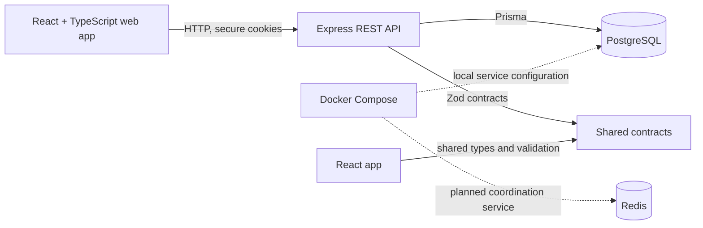
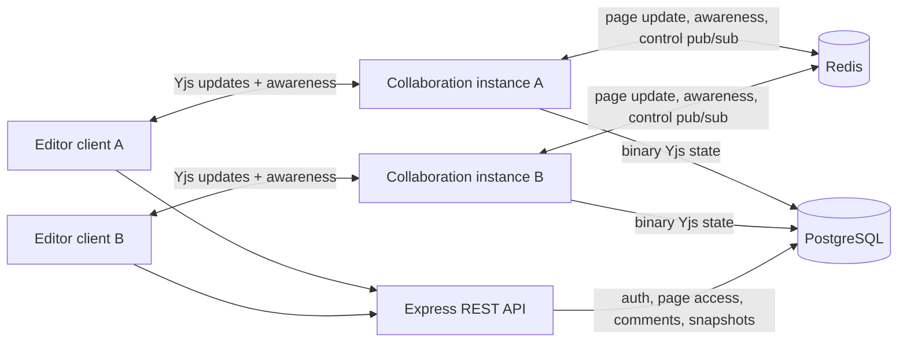

# Architecture

## Current implementation

The browser calls the Express API with credentials included. Registration and login set HTTP-only access and refresh cookies. Protected API requests verify the JWT and check that its session is still active in PostgreSQL. Workspace/page/comment authorization is enforced in API services.

## Collaboration architecture in code; runtime proof pending

The following path is implemented in code. Database and multi-instance behavior still needs runtime verification:

PostgreSQL stores binary Yjs document state, and the Hocuspocus Redis extension distributes document updates and awareness between instances. Snapshot restore is not implemented. See ADRs 001–006 for the recorded design and [implementation progress](../IMPLEMENTATION_PROGRESS.md) for runtime evidence.

## Current security boundaries

- Workspace lists are scoped to the authenticated user's memberships.
- Page access requires workspace membership and resolves a per-page `VIEW`, `COMMENT`, or `EDIT` override; workspace owners/admins are elevated to `EDIT`.
- Comment creation/replies require `COMMENT`; page-level metadata management is restricted to workspace owners/admins.
- Refresh and access credentials are issued through HTTP-only cookies and omitted from auth JSON response bodies.
- Access JWTs are checked against their database session on protected API requests, so logout revocation takes effect immediately.

See [API documentation](api.md) for current routes and [implementation progress](../IMPLEMENTATION_PROGRESS.md) for test status and known gaps.
