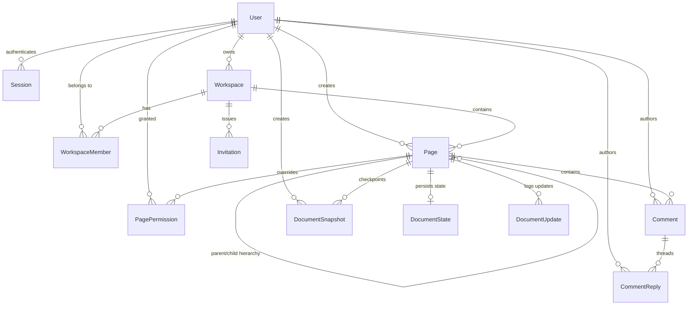

# Collaborative Workspace Data Model

## Overview

The application uses PostgreSQL 16 as its relational, durable database, managed via Prisma ORM. It models multi-tenant workspaces, hierarchical nested pages, granular permission access controls, durable Yjs CRDT document binary state, comments, versions, and invitation lifecycles.

---

## Entity Relationship Diagram

---

## Entities & Table Definitions

### 1. `users`

Represents an authenticated user account.

- `id` (String, PK, CUID): Unique user identifier.
- `email` (String, Unique): Lowercased user email address.
- `passwordHash` (String): Secure salted password hash (bcrypt / argon2). Plaintext passwords are never stored.
- `name` (String): Display name.
- `avatarUrl` (String, Nullable): URL to user avatar.
- `createdAt` / `updatedAt` (DateTime): Timestamps.

### 2. `sessions`

Tracks active refresh tokens and session validity.

- `id` (String, PK, CUID)
- `userId` (String, FK -> `users.id`, onDelete: Cascade)
- `tokenHash` (String, Unique): SHA-256 hash of refresh token.
- `expiresAt` (DateTime): Expiration timestamp.
- `revokedAt` (DateTime, Nullable): Explicit logout/revocation timestamp.
- **Indexes**: `[userId]`, `[tokenHash]`

### 3. `workspaces`

Tenant boundary containing pages and members.

- `id` (String, PK, CUID)
- `name` (String): Workspace display name.
- `ownerId` (String, FK -> `users.id`, onDelete: Restrict): Owner user ID.
- `createdAt` / `updatedAt` (DateTime)
- **Indexes**: `[ownerId]`

### 4. `workspace_members`

Association between a user and a workspace with role definition.

- `id` (String, PK, CUID)
- `workspaceId` (String, FK -> `workspaces.id`, onDelete: Cascade)
- `userId` (String, FK -> `users.id`, onDelete: Cascade)
- `role` (Enum `WorkspaceRole`: `OWNER`, `ADMIN`, `MEMBER`)
- `joinedAt` (DateTime)
- **Constraints**: Unique `(workspaceId, userId)`
- **Indexes**: `[workspaceId]`, `[userId]`

### 5. `pages`

Document node in a workspace, supporting arbitrary nesting.

- `id` (String, PK, CUID)
- `workspaceId` (String, FK -> `workspaces.id`, onDelete: Cascade)
- `parentId` (String, Nullable, FK -> `pages.id`, onDelete: Cascade): Self-referential parent page pointer.
- `creatorId` (String, FK -> `users.id`, onDelete: Restrict)
- `title` (String, default: "Untitled")
- `icon` (String, Nullable): Emoji or icon identifier.
- `position` (Float, default: 0): Fractional ordering index.
- `isArchived` (Boolean, default: false)
- `createdAt` / `updatedAt` (DateTime)
- **Indexes**: `[workspaceId, parentId]`, `[workspaceId, position]`, `[workspaceId, isArchived]`

### 6. `page_permissions`

Granular per-page access level overriding workspace default.

- `id` (String, PK, CUID)
- `pageId` (String, FK -> `pages.id`, onDelete: Cascade)
- `userId` (String, FK -> `users.id`, onDelete: Cascade)
- `permission` (Enum `PagePermissionLevel`: `VIEW`, `COMMENT`, `EDIT`)
- `createdAt` / `updatedAt` (DateTime)
- **Constraints**: Unique `(pageId, userId)`
- **Indexes**: `[pageId]`, `[userId]`

### 7. `document_states`

Canonical durable representation of the Yjs document state.

- `id` (String, PK, CUID)
- `pageId` (String, Unique, FK -> `pages.id`, onDelete: Cascade)
- `state` (`bytea` / `Bytes`): Full Yjs binary encoded document state (`Y.encodeStateAsUpdate(doc)`).
- `version` (Int, default: 1): Monotonically increasing revision counter.
- `updatedAt` (DateTime)

### 8. `document_updates`

Optional append-only CRDT update log.

- `id` (String, PK, CUID)
- `pageId` (String, FK -> `pages.id`, onDelete: Cascade)
- `update` (`bytea` / `Bytes`): Binary CRDT update bytes.
- `actorId` (String, Nullable)
- `sequence` (Int): Sequence counter.
- `createdAt` (DateTime)
- **Indexes**: `[pageId, sequence]`

### 9. `comments`

Discussion threads on a document.

- `id` (String, PK, CUID)
- `pageId` (String, FK -> `pages.id`, onDelete: Cascade)
- `authorId` (String, FK -> `users.id`, onDelete: Cascade)
- `content` (String): Comment body.
- `anchorFrom` / `anchorTo` (Int, Nullable): ProseMirror document position range.
- `anchorText` (String, Nullable): Text snippet anchor.
- `isResolved` (Boolean, default: false)
- `createdAt` / `updatedAt` (DateTime)
- **Indexes**: `[pageId, createdAt]`, `[authorId]`

### 10. `comment_replies`

Threaded replies to a comment.

- `id` (String, PK, CUID)
- `commentId` (String, FK -> `comments.id`, onDelete: Cascade)
- `authorId` (String, FK -> `users.id`, onDelete: Cascade)
- `content` (String)
- `createdAt` / `updatedAt` (DateTime)
- **Indexes**: `[commentId, createdAt]`

### 11. `document_snapshots`

Immutable checkpoints and milestones of document history.

- `id` (String, PK, CUID)
- `pageId` (String, FK -> `pages.id`, onDelete: Cascade)
- `creatorId` (String, FK -> `users.id`, onDelete: Cascade)
- `label` (String, Nullable): Human-readable name.
- `state` (`bytea` / `Bytes`): Restorable binary Yjs state.
- `preview` (String, Nullable): JSON or text preview.
- `createdAt` (DateTime)
- **Indexes**: `[pageId, createdAt]`

### 12. `invitations`

Workspace invitation tokens.

- `id` (String, PK, CUID)
- `workspaceId` (String, FK -> `workspaces.id`, onDelete: Cascade)
- `email` (String)
- `role` (Enum `WorkspaceRole`)
- `tokenHash` (String, Unique)
- `expiresAt` (DateTime)
- `acceptedAt` (DateTime, Nullable)
- `createdAt` (DateTime)
- **Indexes**: `[workspaceId, email]`, `[tokenHash]`
